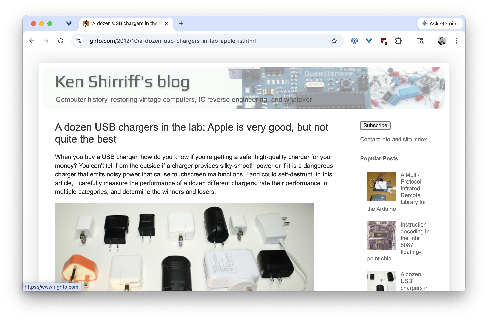
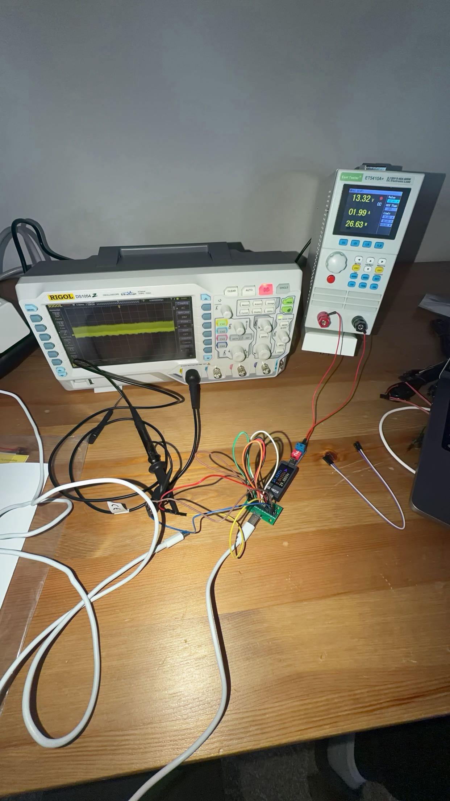
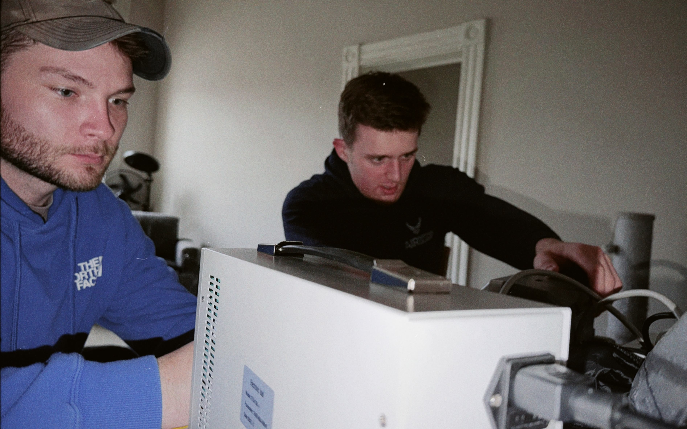

## A Dozen+ Chargers in the Lab: Apple is Okay, but Not the Best

<!-- INTRO: Write your opening paragraph(s) here. Why did you test this? What inspired you? (e.g. Ken Shirriff) What is the reader going to learn? -->

Have you ever wondered what makes a phone charger good or bad? Apple always says to use their certified chargers, but do you have to? Are there really any such things as bad chargers?

I'd thought about this for years ever since I read a [blog post by one legendary Google engineer Ken Shirriff](https://www.righto.com/2012/10/a-dozen-usb-chargers-in-lab-apple-is.html). It was at the top of [Hacker News](https://news.ycombinator.com/) at the time, many years ago. Ken made the case that there is absolutely a difference between the best and worst chargers, and that poorly built chargers have the ability to degrade battery life and even cause other strange issues like touchscreen failure.

While most of his work went over my head at the time, I kept thinking about whether anyone had recreated this for modern USB-C chargers. Fast forward six years, and I still have yet to find anything. For that reason, I decided to figure out exactly what Ken did, and to recreate it. I reached out to a good friend of mine, and we bounced ideas back and forth until this project eventually came to life. He helped me complete some of the work below. Thanks, Spencer!

Here's the short version of what I found out: 
- GaN chargers are among the best you can buy today, and the marketing around them IS real.
- Cheap chargers can also perform well, so the price you pay for a charger doesn't always correlate to its performance.
- Common brands like Apple land solidly in the middle, but some smaller brands edge them out in quality. 
- There is an extreme amount of variation even within a brand. Some produce both high-quality and extremely low-quality chargers, and you'd have no way of knowing unless you tested them.

 

<figure>
  
  <figcaption>Ken Shirriff's original charger teardown article from 2012</figcaption>
</figure>

---

## What I tested

I wanted to get as much out of this project as I could, so just about two dozen USB C chargers were tested. Some USB A chargers were added in as well. I tested everything I could get my hands on, honestly.
Chargers:
- Anker ASPD053a USB C 
- AOHI GaN 65W AOC-C019 
- AOHI GaN 100W AOC-C018 
- Amazon Kindle 9W PS57CP 
- SHARGEEK 35W Retro S035U  
- Apple HomePod Mini A2305 (Same as Apple 20W Retail charger)
- Apple 30W Retail A2164
- Eero 15W C110011
- Anker 100W A121B GaN Flagship
- Anker Nano 45W A121D GaN Flagship
- Spigen PowerArc ArcStation Pro 30W GaN PE2013UJ
- Apple 96W Retail A2166
- VEBNER 65W PD65U55
- Govee 10W BI12T-050200-BdUU
- Counterfeit AT&T 10W 'NA010050020'
- Counterfeit Chinese Wall Adapter 10.5W WP2UWR
- Counterfeit Samsung 10W EP-TA20JBE

I also tested a Macbook Pro M1, an iPhone 17 Pro, and an Anker 621 MAG GO 5000mAh Battery for fun. These aren't chargers, so I'll keep them out of the list above, but they are included in results tables below.

For each charger, I tested it on several dimensions: Advertised power vs actual power, power quality, and overcurrent. 
- The **advertised power vs actual power** tells you how well the charger can maintain its intended voltage while pulling its maximum current. 
- **Power quality** means the amount of noise that appears on an oscilloscope. This comes in many forms, but the general idea is that each oscilloscope graph should be as flat as possible.
- For overcurrent, I tested each device to see what was **the current and voltage at its shutoff point**. I took an electronic load through a series of current levels that were higher than what each charger indicated was its max. At its shutoff point, I noted down the current and voltage that were pulled. For this test, the ideal charger is one that can hold its voltage completely steady and then shut off.

## Testing Setup

As it turns out, testing USB C cables is a little complex. Modern chargers rely on the USB C Power Delivery (PD) standard, which generally specifies five voltages they can choose from: 5V, 9V, 12V, 15V, 20V. There are even more modern variants such as Programmable Power Supply (PPS) and Adjustable Voltage Supply (AVS) but I won't get into those. For this project, I just tested chargers according to the USB C PD spec. I downloaded the full spec as well to see what kinds of testing results would be acceptable, too.

My setup consisted of three distinct pieces:
1. An oscilloscope, specifically the Rigol DS1054Z
2. An electronic load
3. A USB C Power Delivery decoy board
4. A voltmeter

I would plug the charger into the wall, connect it to the USB C decoy board via USB C, then connect the decoy board to the electronic load. 
The purpose of the decoy board is to imitate a device and requests a specific USB C PD voltage from the USB C charger. *Ken didn't need this piece since his chargers were constant voltage, but mine unfortunately do require it.* 

The Rigol DS1054Z was set up with its probe touching the positive terminal on the decoy board, and its ground touching the negative terminal. I used the spring-based ground clip instead of the alligator ground clip for more accurate measurements.
*Tip: If you want to do testing of your own, always use the spring ground clip. I learned the hard way that using the default alligator ground clip will lead to extremely high noise ratings. Chargers will look bad on the scope even if they are high-quality.*

### A note about resistance

I learned during this project that resistance could be artificially skewing my measurements. For that reason, I used a voltmeter connected directly to the charger's output terminal for ALL tables below, which is essentially every test aside from the noise/ripple with the oscilloscope. 

If you're interested, the equivalent resistance of my voltmeter during testing was 6.67 mΩ, and the entire system (cable + breakout board + voltmeter) was 170 mΩ. I'm honestly proud of how reasonable that is for a testing setup, considering USB C cables themselves are allowed to carry a resistance of up to 166 mΩ per the USB C PD spec. 

### Rating system for Oscilloscope graphs - Noise and ripple

Each charger is rated 1 to 5 lightning bolts across three categories: noise, ripple, and an overall score. The bolt ratings loosely map to measured peak-to-peak voltage noise on the oscilloscope:

- 5 bolts: under approximately 80mV
- 4 bolts: under approximately 100mV
- 3 bolts: under approximately 160mV
- 2 bolts: under approximately 250mV
- 1 bolt: anything above that

These are just general guidelines. I used my judgment for each charger based on everything I could see, including the shape of the waveform and the FFT spectrum, not just the raw mV reading.

<figure style="max-width: 300px;">
  
  <figcaption>My original setup with the oscilloscope (before I started using USB C Decoy boards)</figcaption>
</figure>

---

## The Results

Scroll through the cards and click any one to expand the full oscilloscope traces. Each card shows the worst graph I could reproduce for that charger, assuming typical power usage. 
- I learned during testing that all devices showed similar noise profiles at different voltages, so I stuck with lower voltages for these screenshots. Most screenshots below were taken when the charger was giving 9V.
- Within each voltage, I cycled through each charger's range of allowable current, and usually selected the worst graph. If the charger showed noise at the extreme low or high end of current, but no issues for the vast majority of measurements, I would take the less severe graph. This is because I want what you're seeing to approximate the noise your device would *actually* experience during  charging, not some hypothetical rating you will never actually see during normal usage.

## Oscilloscope Graphs

  
  

    
{{ item.name }}

    

      

        
{{ item.name }}

      

      

        

          
          
          
          
          
          
        

        

          

            Overall rating:
            
              
              ⚡︎
            
          

          <figcaption>{{ item.caption | strip }}</figcaption>
          <button class="expand-btn">Expand</button>
        

      

    

  

  

  

    

  

  ←← BETTER
  WORSE →→

  click anywhere to dismiss
  

    

      

      <button class="modal-close-btn" onclick="closeModal()" aria-label="Close modal">✕</button>
    

    

      

        <!-- Content injected by JS -->
      

    

  

 

### Oscilloscope Graphs - Results Table

<table>
  <thead>
    <tr>
      <th>Charger</th>
      <th>Noise in mV</th>
      <th>Noise Rating (Graph 1)</th>
      <th>Ripple Rating (Graphs 2 &amp; 3)</th>
    </tr>
  </thead>
  <tbody>
    <tr class="battery-row">
      <td><strong>Macbook Pro M1</strong></td>
      <td>24mV</td>
      <td>&#x26A1;&#xFE0E;&#x26A1;&#xFE0E;&#x26A1;&#xFE0E;&#x26A1;&#xFE0E;&#x26A1;&#xFE0E;</td>
      <td>N/A</td>
    </tr>
    <tr class="battery-row">
      <td><strong>Anker 621 MAG GO 5000mAh Battery</strong></td>
      <td>36mV</td>
      <td>&#x26A1;&#xFE0E;&#x26A1;&#xFE0E;&#x26A1;&#xFE0E;&#x26A1;&#xFE0E;&#x26A1;&#xFE0E;</td>
      <td>&#x26A1;&#xFE0E;&#x26A1;&#xFE0E;&#x26A1;&#xFE0E;&#x26A1;&#xFE0E;</td>
    </tr>
    <tr>
      <td><strong>Spigen PowerArc ArcStation Pro</strong></td>
      <td>56mV</td>
      <td>&#x26A1;&#xFE0E;&#x26A1;&#xFE0E;&#x26A1;&#xFE0E;&#x26A1;&#xFE0E;&#x26A1;&#xFE0E;</td>
      <td>&#x26A1;&#xFE0E;&#x26A1;&#xFE0E;&#x26A1;&#xFE0E;&#x26A1;&#xFE0E;&#x26A1;&#xFE0E;</td>
    </tr>
    <tr>
      <td><strong>AOHI GaN 65W Charger</strong></td>
      <td>60mV</td>
      <td>&#x26A1;&#xFE0E;&#x26A1;&#xFE0E;&#x26A1;&#xFE0E;&#x26A1;&#xFE0E;&#x26A1;&#xFE0E;</td>
      <td>&#x26A1;&#xFE0E;&#x26A1;&#xFE0E;&#x26A1;&#xFE0E;&#x26A1;&#xFE0E;&#x26A1;&#xFE0E;</td>
    </tr>
    <tr>
      <td><strong>Eero 15W Charger</strong></td>
      <td>60mV</td>
      <td>&#x26A1;&#xFE0E;&#x26A1;&#xFE0E;&#x26A1;&#xFE0E;&#x26A1;&#xFE0E;&#x26A1;&#xFE0E;</td>
      <td>&#x26A1;&#xFE0E;&#x26A1;&#xFE0E;&#x26A1;&#xFE0E;</td>
    </tr>
    <tr>
      <td><strong>AOHI 100w GaN Charger</strong></td>
      <td>72mV</td>
      <td>&#x26A1;&#xFE0E;&#x26A1;&#xFE0E;&#x26A1;&#xFE0E;&#x26A1;&#xFE0E;&#x26A1;&#xFE0E;</td>
      <td>&#x26A1;&#xFE0E;&#x26A1;&#xFE0E;&#x26A1;&#xFE0E;&#x26A1;&#xFE0E;&#x26A1;&#xFE0E;</td>
    </tr>
    <tr>
      <td><strong>Anker 637 Magnetic Charging Station</strong></td>
      <td>76mV</td>
      <td>&#x26A1;&#xFE0E;&#x26A1;&#xFE0E;&#x26A1;&#xFE0E;&#x26A1;&#xFE0E;&#x26A1;&#xFE0E;</td>
      <td>&#x26A1;&#xFE0E;&#x26A1;&#xFE0E;&#x26A1;&#xFE0E;&#x26A1;&#xFE0E;&#x26A1;&#xFE0E;</td>
    </tr>
    <tr>
      <td><strong>Counterfeit Chinese Wall Charger</strong>USB A Only</td>
      <td>84mV</td>
      <td>&#x26A1;&#xFE0E;&#x26A1;&#xFE0E;&#x26A1;&#xFE0E;&#x26A1;&#xFE0E;</td>
      <td>&#x26A1;&#xFE0E;&#x26A1;&#xFE0E;&#x26A1;&#xFE0E;</td>
    </tr>
    <tr>
      <td><strong>Apple 96W Macbook Charger</strong></td>
      <td>92mV</td>
      <td>&#x26A1;&#xFE0E;&#x26A1;&#xFE0E;&#x26A1;&#xFE0E;&#x26A1;&#xFE0E;</td>
      <td>&#x26A1;&#xFE0E;&#x26A1;&#xFE0E;&#x26A1;&#xFE0E;&#x26A1;&#xFE0E;</td>
    </tr>
    <tr>
      <td><strong>Apple 30W Retail Charger</strong></td>
      <td>96mV</td>
      <td>&#x26A1;&#xFE0E;&#x26A1;&#xFE0E;&#x26A1;&#xFE0E;</td>
      <td>&#x26A1;&#xFE0E;&#x26A1;&#xFE0E;&#x26A1;&#xFE0E;</td>
    </tr>
    <tr>
      <td><strong>Anker ASPD053a</strong></td>
      <td>128mV</td>
      <td>&#x26A1;&#xFE0E;&#x26A1;&#xFE0E;&#x26A1;&#xFE0E;</td>
      <td>&#x26A1;&#xFE0E;&#x26A1;&#xFE0E;&#x26A1;&#xFE0E;</td>
    </tr>
    <tr class="battery-row">
      <td><strong>iPhone 17 pro</strong></td>
      <td>136mV</td>
      <td>&#x26A1;&#xFE0E;&#x26A1;&#xFE0E;&#x26A1;&#xFE0E;</td>
      <td>N/A</td>
    </tr>
    <tr>
      <td><strong>Shargeek Macintosh Charger</strong></td>
      <td>152mV</td>
      <td>&#x26A1;&#xFE0E;&#x26A1;&#xFE0E;&#x26A1;&#xFE0E;</td>
      <td>&#x26A1;&#xFE0E;&#x26A1;&#xFE0E;&#x26A1;&#xFE0E;</td>
    </tr>
    <tr>
      <td><strong>Govee Power Supply</strong>USB A Only</td>
      <td>164mV</td>
      <td>&#x26A1;&#xFE0E;&#x26A1;&#xFE0E;</td>
      <td>&#x26A1;&#xFE0E;&#x26A1;&#xFE0E;</td>
    </tr>
    <tr>
      <td><strong>Anker A121B 100W Charger</strong></td>
      <td>200mV</td>
      <td>&#x26A1;&#xFE0E;&#x26A1;&#xFE0E;</td>
      <td>&#x26A1;&#xFE0E;&#x26A1;&#xFE0E;</td>
    </tr>
    <tr>
      <td><strong>Dealworthy Charger</strong></td>
      <td>212mV</td>
      <td>&#x26A1;&#xFE0E;&#x26A1;&#xFE0E;</td>
      <td>&#x26A1;&#xFE0E;&#x26A1;&#xFE0E;</td>
    </tr>
    <tr>
      <td><strong>Anker A121D 45W iPhone 17 Charger</strong></td>
      <td>244mV</td>
      <td>&#x26A1;&#xFE0E;</td>
      <td>&#x26A1;&#xFE0E;</td>
    </tr>
    <tr>
      <td><strong>Counterfeit AT&amp;T</strong>USB A Only</td>
      <td>260mV</td>
      <td>&#x26A1;&#xFE0E;&#x26A1;&#xFE0E;&#x26A1;&#xFE0E;</td>
      <td>&#x26A1;&#xFE0E;&#x26A1;&#xFE0E;&#x26A1;&#xFE0E;</td>
    </tr>
    <tr>
      <td><strong>Amazon Kindle Charger</strong></td>
      <td>288mV</td>
      <td>&#x26A1;&#xFE0E;&#x26A1;&#xFE0E;</td>
      <td>&#x26A1;&#xFE0E;</td>
    </tr>
    <tr>
      <td><strong>Apple HomePod Mini Charger</strong></td>
      <td>308mV</td>
      <td>&#x26A1;&#xFE0E;</td>
      <td>&#x26A1;&#xFE0E;&#x26A1;&#xFE0E;</td>
    </tr>
    <tr>
      <td><strong>Vebner GaN 65W Charger</strong></td>
      <td>332mV</td>
      <td>&#x26A1;&#xFE0E;</td>
      <td>&#x26A1;&#xFE0E;</td>
    </tr>
    <tr>
      <td><strong>Counterfeit Samsung</strong></td>
      <td>468mV</td>
      <td>&#x26A1;&#xFE0E;</td>
      <td>&#x26A1;&#xFE0E;</td>
    </tr>
  </tbody>
</table>

## Expected/Actual Output
Before we get into this table, I want to make one caveat: my setup was not robust enough to handle testing at the full 65W or 100W that certain chargers are rated for. That is why I tested each charger at *one* of its max current/ voltage configurations. Say Charger A Is called a "65W" charger on the box. Charger A supports:
- 20V, up to 3.25 A (to reach max power of 65W)
And it *also* supports:
- 5V, up to 3 A
- 9V, up to 3 A
- 12V, up to 3 A
- 15V, up to 3 A

In this case, I'd do base level testing to see if I can get the charger to output its max power for a second or two. Then, for the oscilloscope traces, I would drop the device down to something like 9V and cycle through all its current levels. This is so that I could avoid overheating my breakout board. As stated earlier, *all* chargers showed similar noise profiles at their different voltages, so I am confident that the results you see below are reproducible, even if your device uses one voltage setting under or above what I did.

The Actual Voltage column is highlighted green if the measured voltage is within ±5% of the nominal output voltage (the USB-C PD spec limit) and red if it falls outside that window in either direction. For example, a 5V output must stay between 4.75V and 5.25V.

(For added fun, I also tested a few batteries and DC-powered devices — they aren’t directly comparable to AC chargers since they produce no switching noise by nature, but I’ve included them in grey below as a reference.)
### Expected/Actual Output Table

<table class="stats-table">
  <thead>
    <tr>
      <th>Charger</th>
      <th>Attempted To Pull (W)</th>
      <th>Actual Voltage (V)</th>
      <th>Actual Current (A)</th>
      <th>Actual Power (W)</th>
      <th>Passes Spec?</th>
    </tr>
  </thead>
  <tbody>
    <tr><td><strong>Eero 15W Charger</strong></td><td>15 (5v, 3a)</td><td class="diff-pos">4.76</td><td>2.91</td><td>13.85</td><td class="diff-pos">&#x2713;</td></tr>
    <tr><td><strong>Shargeek Macintosh Charger</strong></td><td>27 (9v, 3a)</td><td class="diff-pos">8.9</td><td>3.0</td><td>27.0</td><td class="diff-pos">&#x2713;</td></tr>
    <tr><td><strong>Apple 30W Retail Charger</strong></td><td>30 (20v, 1.5a)</td><td class="diff-pos">20.04</td><td>1.42</td><td>28.45</td><td class="diff-pos">&#x2713;</td></tr>
    <tr><td><strong>Apple HomePod Mini Charger</strong></td><td>19.98 (9v 2.22a)</td><td class="diff-pos">8.90</td><td>2.23</td><td>19.85</td><td class="diff-pos">&#x2713;</td></tr>
    <tr><td><strong>Vebner GaN 65W Charger</strong></td><td>27 (9v, 3a)</td><td class="diff-pos">8.64</td><td>3.04</td><td>26.26</td><td class="diff-pos">&#x2713;</td></tr>
    <tr><td><strong>Govee Power Supply</strong>USB A Only</td><td>10 (5v, 2a)</td><td class="diff-pos">5.04</td><td>2.02</td><td>10.18</td><td class="diff-pos">&#x2713;</td></tr>
    <tr><td><strong>Counterfeit AT&amp;T</strong>USB A Only</td><td>10 (5v, 2a)</td><td class="diff-neg">5.38</td><td>2.01</td><td>10.81</td><td class="diff-neg">&#x2717;</td></tr>
    <tr><td><strong>Counterfeit Samsung</strong></td><td>10 (5v, 2a)</td><td class="diff-neg">4.4</td><td>2.0</td><td>8.9</td><td class="diff-neg">&#x2717;</td></tr>
    <tr><td><strong>Amazon Kindle Charger</strong></td><td>9.36 (5.2v, 1.8a)</td><td class="diff-neg">5.30</td><td>1.81</td><td>9.59</td><td class="diff-neg">&#x2717;</td></tr>
    <tr><td><strong>Counterfeit Chinese Wall Charger</strong>USB A Only</td><td>10.5 (5v, 2.1a)</td><td class="diff-neg">4.5</td><td>2.13</td><td>9.6</td><td class="diff-neg">&#x2717;</td></tr>
    <tr><td><strong>Dealworthy Charger</strong></td><td>20 (12v, 1.67a)</td><td class="diff-pos">11.97</td><td>1.57</td><td>18.79</td><td class="diff-pos">&#x2713;</td></tr>
    <tr class="battery-row"><td><strong>Anker 621 MAG GO 5000mAh Battery</strong></td><td>12</td><td class="diff-neg">4.74</td><td>2.43</td><td>11.54</td><td class="diff-neg">&#x2717;</td></tr>
    <tr class="battery-row"><td><strong>iPhone 17 pro</strong></td><td>4.5</td><td class="diff-pos">4.81</td><td>1.12</td><td>5.39</td><td class="diff-pos">&#x2713;</td></tr>
    <tr class="battery-row"><td><strong>Macbook Pro M1</strong></td><td>15 (5v, 3a)</td><td class="diff-pos">5.05</td><td>3.03</td><td>15.30</td><td class="diff-pos">&#x2713;</td></tr>
    <tr><td><strong>Anker ASPD053a</strong></td><td>27 (9v, 3a)</td><td class="diff-pos">8.88</td><td>3.02</td><td>26.82</td><td class="diff-pos">&#x2713;</td></tr>
    <tr><td><strong>Apple 96W Macbook Charger</strong></td><td>45 (15v, 3a)</td><td class="diff-pos">15.08</td><td>3.02</td><td>45.54</td><td class="diff-pos">&#x2713;</td></tr>
    <tr><td><strong>AOHI 100W GaN Charger</strong></td><td>36 (12v, 3a)</td><td class="diff-pos">11.82</td><td>3.02</td><td>35.52</td><td class="diff-pos">&#x2713;</td></tr>
    <tr><td><strong>Anker 637 Magnetic Charging Station</strong></td><td>15 (5v, 3a)</td><td class="diff-neg">4.74</td><td>3.04</td><td>14.4</td><td class="diff-neg">&#x2717;</td></tr>
    <tr><td><strong>Spigen PowerArc ArcStation Pro</strong></td><td>27 (9v, 3a)</td><td class="diff-pos">8.91</td><td>3.02</td><td>26.91</td><td class="diff-pos">&#x2713;</td></tr>
    <tr><td><strong>Anker A121D 45W iPhone 17 Charger</strong></td><td>45 (15v, 3a)</td><td class="diff-pos">14.82</td><td>3.03</td><td>44.90</td><td class="diff-pos">&#x2713;</td></tr>
    <tr><td><strong>Anker A121B 100W Charger</strong></td><td>45 (15v, 3a)</td><td class="diff-pos">14.99</td><td>3.02</td><td>45.26</td><td class="diff-pos">&#x2713;</td></tr>
    <tr><td><strong>AOHI GaN 65W Charger</strong></td><td>36 (12v, 3a)</td><td class="diff-pos">12.13</td><td>3.02</td><td>36.63</td><td class="diff-pos">&#x2713;</td></tr>
  </tbody>
</table>

 

 

## Overcurrent Testing

The last piece of Ken Shirriff's testing I wanted to replicate was overcurrent. Naturally, since devices get to decide how much current they want to pull, it's up to the charger to make sure the device doesn't pull too much current. Like I mentioned earlier, chargers generally have two strategies to deal with this: 1) shut off completely, or 2) reduce the voltage. Option 1 is preferred, and option 2 is mostly available just due to the laws of physics.

During overcurrent testing, I set my electronic load to keep pulling more and more current until the charger shut off. For nearly every charger I tested, it was rated for a max of 3 A. But as you'll see in the table below, that is rarely what I got.

Ken was able to display the complex relationship between voltage and current on beautiful time-based graphs. I don't have access to technology that can display the results in the same way. I CAN tell you, however, that all my voltage graphs were relatively tight during overcurrent testing, and I only had one charger (Counterfeit Samsung) that completely blew the test. The others did a great job of keeping their voltage within a reasonable range, even during overcurrent. For that reason, you should have no problem accepting the values below as the true values of the voltage and current of the device at its shutoff period. 

The ideal value here is having a voltage equal to 5V or 9V. You don't want 3 or 4 volts, or 7 or 8 volts, because that suggests the charger allowed more current out than it should have.

*I don't have overcurrent results for all chargers in the table below. This will be updated as more test results become available.*

### Overcurrent Results Table

<table class="overcurrent-table">
  <thead>
    <tr>
      <th>Adapter</th>
      <th>Difference between advertised Current and Current at shutoff</th>
      <th>Difference between advertised Voltage and Voltage at shutoff</th>
      <th>Difference between advertised Power and Power at Shutoff (W)</th>
    </tr>
  </thead>
  <tbody>
    <tr><td><strong>Vebner GaN</strong></td><td>0.42</td><td class="oc-pos">0.13</td><td class="oc-pos">2.5</td></tr>
    <tr><td><strong>AOHI GaN 100W</strong></td><td>0.6</td><td class="oc-pos">0.13</td><td class="oc-pos">3.5</td></tr>
    <tr><td><strong>Anker A121B 100W GaN Charger</strong></td><td>0.35</td><td class="oc-pos">0.12</td><td class="oc-pos">2.2</td></tr>
    <tr><td><strong>Anker A121D 45W iPhone 17 Charger</strong></td><td>0.44</td><td class="oc-neg">-0.09</td><td class="oc-pos">1.9</td></tr>
    <tr><td><strong>Apple HomePod Mini (20W)</strong></td><td>0.42</td><td class="oc-neg">-0.11</td><td class="oc-pos">1.7</td></tr>
    <tr><td><strong>Apple 30W Retail</strong></td><td>0.17</td><td class="oc-neg">-0.14</td><td class="oc-pos">0.4</td></tr>
    <tr><td><strong>Apple 96W</strong></td><td>0.46</td><td class="oc-neg">-0.37</td><td class="oc-pos">1.1</td></tr>
    <tr><td><strong>Amazon Kindle</strong></td><td>0.1</td><td class="oc-neg">-0.4</td><td class="oc-neg">-0.2</td></tr>
    <tr><td><strong>Spigen PowerArc ArcStation</strong></td><td>0.22</td><td class="oc-neg">-0.27</td><td class="oc-pos">0.2</td></tr>
    <tr><td><strong>AOHI GaN 65W Charger</strong></td><td>0.33</td><td class="oc-neg">-0.3</td><td class="oc-pos">0.7</td></tr>
    <tr><td><strong>Eero 15W Charger</strong></td><td>0.36</td><td class="oc-neg">-0.31</td><td class="oc-pos">0.8</td></tr>
    <tr><td><strong>Counterfeit Chinese Wall Charger</strong></td><td>0.23</td><td class="oc-neg">-0.57</td><td class="oc-neg">-0.2</td></tr>
    <tr><td><strong>Counterfeit Samsung</strong></td><td>0.81</td><td class="oc-neg">-0.13</td><td class="oc-neg">3.73</td></tr>
  </tbody>
</table>

And there you have it. Most chargers did well, and only experienced minor voltage drops. A few of them allowed significantly higher current than advertised, and they seemed to handle it well, suggesting good engineering.

 
 
---
 

## Conclusion

Wow, that was a lot. Evaluating chargers seemed quite difficult at first, but this whole project quickly turned into something fun, that I was excited to spend nights and weekends doing. What I liked most is that you don't need to be an electrical engineer to see the difference between good and bad chargers, since the oscilloscope makes it obvious. The real difficulty comes when you go past the what and try to understand the why: why certain peaks appear in the FFT, why some scope traces look as bad as they do, or why a charger that measured fine at 1A looked terrible at 2.5A. I still don't have great answers to all of those, but hope to learn more with time.

The practical takeaway is more reassuring than the graphs might suggest. Since most modern devices filter noise internally, and *most* chargers I tested stay within the USB-C PD spec of ±5% voltage tolerance, even *with* all their noise, it's still unlikely to damage your battery. 

I hope you enjoyed reading. This was genuinely such a pleasure to put together. Car chargers are next on my list, and I suspect that'll be a story of their own. If you think I rated something incorrectly or mixed up electrical concepts, feel free to reach out and let me know. Contact is on the About page.

### -Sean
 
Last thing: a huge shout out to my mechanical engineering friend Spencer, who helped me at every step of the way! 
<figure style="max-width: 600px; text-align: center;">
  
  <figcaption>Me and Spencer. Best friends make good electrical testing partners!</figcaption>
</figure>
