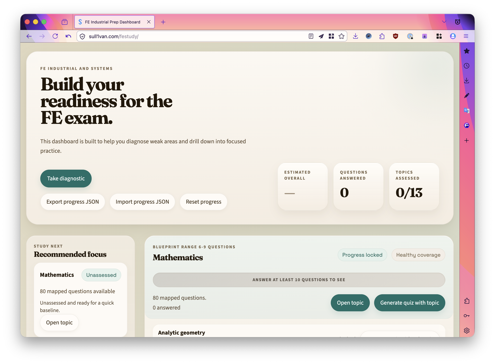

### Hello!

Recently I've taken it upon myself to study for the FE exam. There's a longer term career pivot in the works, but for now I've been focused on getting the best study material possible.

At first, I found the Kaplan/PPI study material. They have a *lot* of questions, but some of them were written poorly and also just incorrect. After paying $150 for a one month membership, I scraped all the questions I could find and ended up with a dataset of over 1000 questions. I don't think they are as relevant to the exam, though, so I found another resource that I think is much better.

Enter [This site](https://sull1van.com/FEStudy). I found a reddit post from another engineer, who said he sourced as many FE questions as possible from around the web, and came up with this dataset. He posted it for free at https://journey2pe.com/. I took his question list and tried my best to parse out the questions vs. the answers, and then format it into a text-only database (which was tough, since it has images). I was able to use AI and spend about two weeks concocting my own website, which is more interactive than his. It's his data, but a better way of visualizing it. 

If you're interested in studying, take a look. I built it for myself but it should be pretty easy for others to pick up.

  

[https://sull1van.com/FEStudy](https://sull1van.com/FEStudy)
