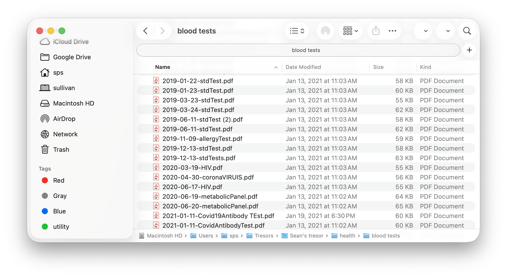
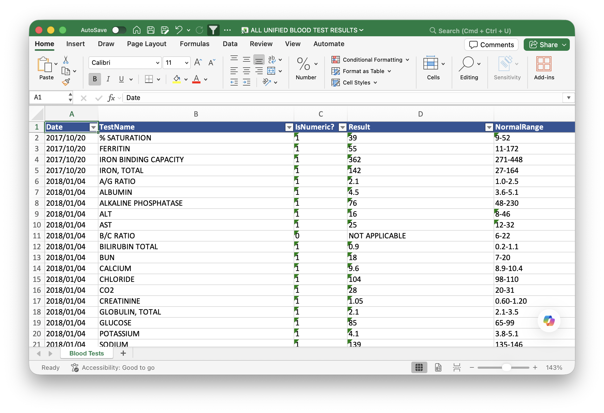
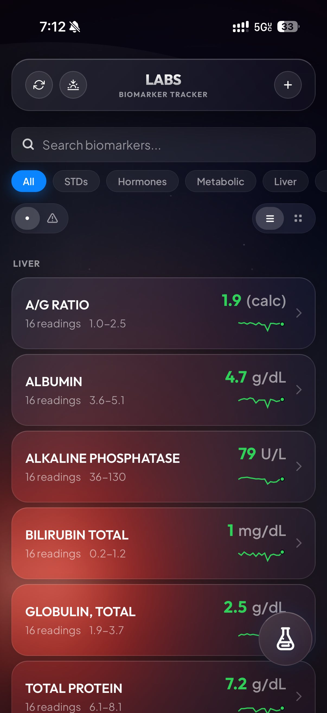
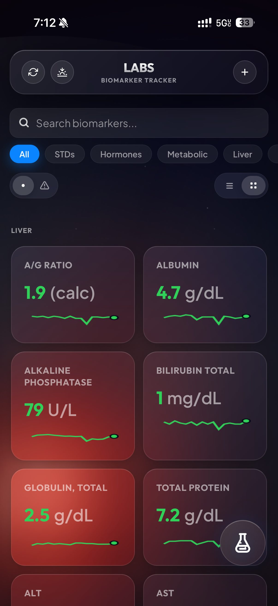
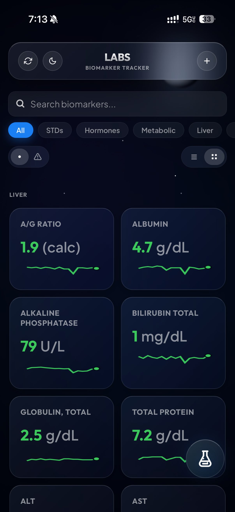
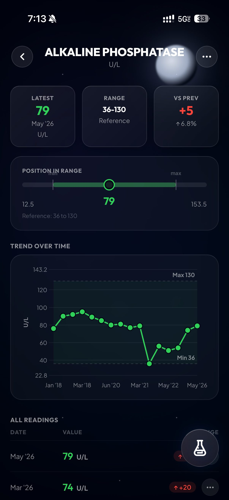
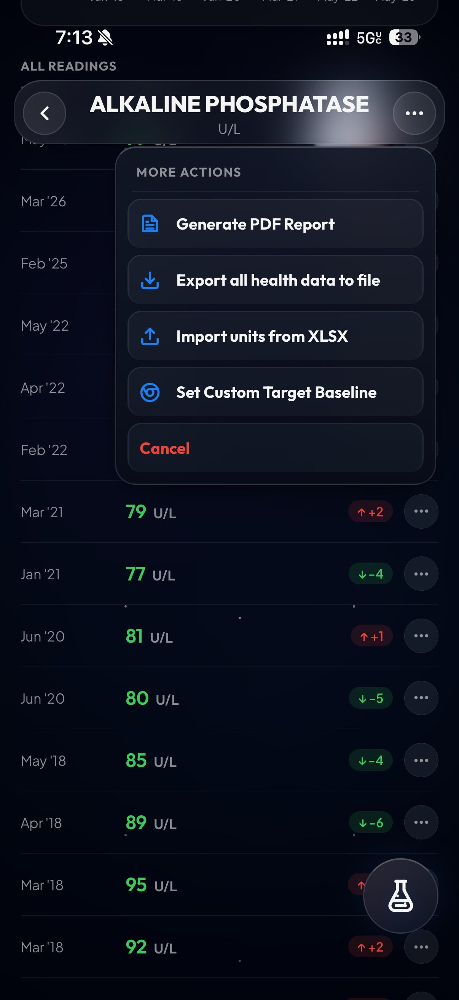
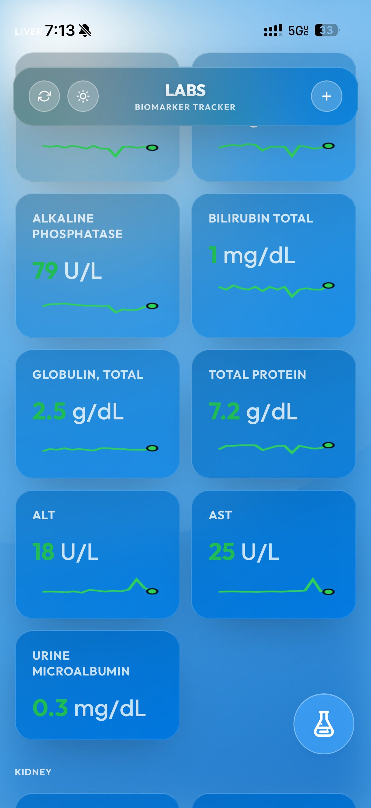
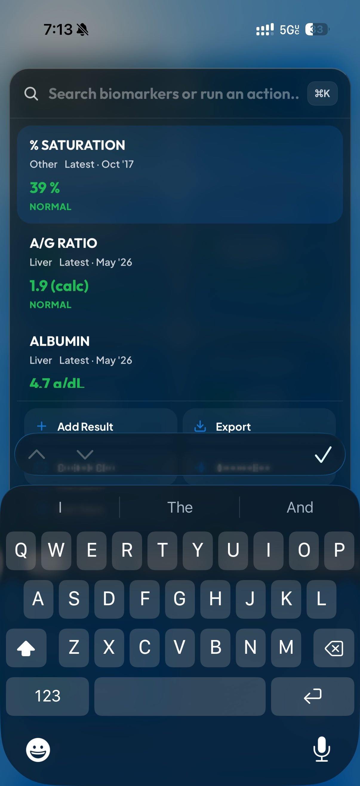

Over one year ago, I made the decision to start focusing on my bloodwork. I had graduated college and taken a renewed interest in my personal health, but I learned that there some some latent damage in my organs. I had just gotten the first comprehensive metabolic panel in years, and the results weren't great. My liver enzymes ALT and AST were extemely high, in such an embarrassing way that it screamed *this person drinks too much alcohol*[1]. I realized that a bigger effort was needed if I was going to take charge of my health.


I started by looking at the data. Luckily for me, I've always had some sort of a focus on health, and I already had some two-dozen PDFs of blood test results dating back to 2018 in a folder on my computer. Every time I would get one, I'd save the results from the doctor as a PDF an drop it into that folder. While it was great to have, it was a mess to actually go through. I really wanted to make some comprehensive Excel spreadsheet with all of it, but assumed it would be too much work for one person to do.

<div style="text-align: center; margin: 2rem auto;">
    
</div>


Enter AI. Now that we have tools like Claude Cowork and OpenAI Codex, I could just delegate some agents to do the heavy lifting for me. 

## My Plan

My plan was pretty simple, just:
1. Command claude or Codex to delegate an army of subagents to process all my PDFs
2. File by file, comprehensively pull all numeric and non-numeric test results out
3. Create a master datasheet with all these results
4. Run a separate set of agents to check the first agents' work, and report any inaccuracies they find.
5. Create a central dashboard to read and manage all my blood test results

Scope creep is lowkey a problem when AI gives you infinite resources, lol. But since I knew I would only be verifying the work, not actually doing it, this all seemed possible.

## How it went

### Steps 1-4: Data conversion
The process was honestly easier than I expected. Claude and Codex both did a great job dispatching agents and converting the blood test results to an excel sheet. What's also really cool is the verification bots didn't find any errors, they just found instances in which the wrong units were used. For example, an ALT test from 2018 used ng/dL, while the ALT from 2020 used ug/L. I did a manual spot check throughout the entire dataset and it looked great.


<div style="text-align: center; margin: 2rem auto;">
    
</div>


### Step 5: The Dashboard

With the data in *some* kind of usable format, this was the part where I had some fun. I started by asking Claude and Codex to both design some rudimentary visual for the labs. My thought process was pretty straightforward: let's make a dual layout, card-based and list-based. User selects between these two views, and it's either one card or one list item per blood test. They will always show the *most recent* result, followed by the relevant unit. They will be color coded green or red, based on whether they fall outside the normal range for that test.

But what constitutes a 'normal range'? **Depends who you ask!**
  My blood test results frequently showed different refernce ranges for the same blood test across the years. I attribute this mainly to the slight differences between how the two behemoths in the space, LabCorp and Quest Diagnostics, calculate their normal range. I did not find significant variability from within the same company, however. 

  Either way, I ended up making a system for that: each blood test record in my backend database, and in my spreadsheet, *includes* the reference range that the lab gave me for that test at the time of taking. Then, the web UI parses it and shows the *most recent* normal range given. Sometimes they don't give a normal range for a test, so the website will keep crawling older and older records, until it finds a record with a reference range. That will be the reference range you see on the display.


### The Frontend

Claude iterated on my design requests a few times, and the early prototypes were ugly. Being inspired by the latest slop iOS update, and wanting something a little better than flat, I pushed the AI to develop a glassmorphic UI. The result is something I'm really proud of:

<style>
  .gallery-section {
    display: flex;
    flex-direction: column;
    gap: 3rem;
    margin: 2rem auto;
  }
  .gallery-row {
    display: grid;
    grid-template-columns: 1fr;
    gap: 1.5rem;
    align-items: center;
  }
  .gallery-images-double {
    display: grid;
    grid-template-columns: 1fr 1fr;
    gap: 1rem;
  }
  .gallery-caption {
    font-size: 0.9em;
    line-height: 1.5;
    color: #666;
  }
  html[data-theme="dark"] .gallery-caption {
    color: #aaa;
  }
  .gallery-img {
    width: 100%;
    max-width: 253px;
    margin: 0 auto;
    display: block;
    border: 4px solid #bbb;
    border-radius: 27px;
    box-shadow: 0 10px 30px rgba(0,0,0,0.1);
    box-sizing: border-box;
  }
  @media (min-width: 550px) {
    .gallery-row.layout-2-1 {
      grid-template-columns: 2.2fr 1fr;
    }
    .gallery-row.layout-1-1 {
      grid-template-columns: 1fr 1fr;
    }
  }
</style>

<div class="gallery-section">
  <!-- Row 1: screen1 & screen2 + caption -->
  <div class="gallery-row layout-2-1">
    <div class="gallery-images-double">
      
      
    </div>
    <div class="gallery-caption">
      Card versus list UI view
    </div>
  </div>

  <!-- Row 2: screen3 + caption -->
  <div class="gallery-row layout-1-1">
    <div>
      
    </div>
    <div class="gallery-caption">
      The UI comes with many different modes, meant to highlight different points throughout the day. I wanted to smiulate the UI of the Apple Weather app, because that is my ideal design for something that shows health data. It actually took a long time to achieve this UI, so I'm proud of the result.
    </div>
  </div>

  <!-- Row 3: screen4 & screen5 + caption -->
  <div class="gallery-row layout-2-1">
    <div class="gallery-images-double">
      
      
    </div>
    <div class="gallery-caption">
      **Left**: detail view showing most recent test, normal range, and units. **Right**: view when you scroll down. Shows all test history, and offers context menus which present additional options
    </div>
  </div>

  <!-- Row 4: screen6 -->
  <div class="gallery-row">
    <div style="max-width: 500px; margin: 0 auto; width: 100%;">
      
    </div>
        <div class="gallery-caption">
      The card view with daytime mode enabled. It was extremely hard to get the UI to this state, so hoenstly I'm blown away it all works.
    </div>
  </div>

  <!-- Row 5: screen7 + caption -->
  <div class="gallery-row layout-1-1">
    <div>
      
    </div>
    <div class="gallery-caption">
      Screenshot of Cmd+K. I don't have a better name for it, but it's triggered by Cmd+K on desktop, so 
    </div>
  </div>
</div>

After I finished, I pulled up some more claude subagents and dispatched them to do bug catching. While in the middle of that, one of them offered up a new feature suggestion that I really liked. That's what you're seeing in the last screenshot: it's a power menu, triggered by tapping the little flask on mobile or hitting Cmd+K on desktop.

When you open it, you can instantly pull up test results, create an export PDF, or even add a new lab. It's really powerful and designed to be my place to drop in when I need to locate a result as fast as possible.

---

That's pretty much the entirety of the UI. I really loved designing it, especially the glass background. I was going for an immitation of Apple Weather, and think that we (me/Claude) knocked it out of the park.


### The Backend

For backend data storage, I decided to use Google Firebase. Why? Well, the only real alternative people seem to be using nowadays is Supabase, and that has an awful free tier. Google's seemed to be better for long-term use, so I went with them. The data model I made was quite funny, hoenstly.

Google Firebase offers you 50K Reads/writes a day, totally free. After that it's some insanely low rate, like $0.03 / 100K reads (don't quote me on that). The other great thing about Firebase is that it has a data record limit of 1MB.

**1 Megabyte! 😂**

So 1 megabyte is about !1 million characters. For reference, the Great Gatsby is estimated to be about 240,000.

That's a lot of characters! My blood test results will never be as long as the Great Gatsby. And so for that reason, **we are storing the entire set of blood test results in one Firestore entry!** 


So it's safe to say that this setup will never cost me a dime. The only remaining question is what the data will look like when we send it to Firebase. I iterated with Claude, and we settled on the following schema for the master dataset:
```json
  {
    "schemaVersion": 1,
    "tests": [
      {
        "name": "string",
        "unit": "",
        "range": "",
        "type": "",
        "points": [
          {
            "date": "YYYY-MM-DD",
            "rawResult": "",
            "lab": "",
            "sourceFile": "",
            "testResultId": "",
            "rawRange": "",
            "unit": "",
            "sourcePage": "",
            "reviewStatus": "",
            "verificationStatus": ""
          }
        ]
      }
    ]
  }
```


This schema looked pretty good. I sent it to firebase, but then realized this was private health data gettting stored into plaintext. There should ideally be some encryption protecting it. 

I thought about different ways to encrypt it. We could encrypt the values themselves, but thought that was stupid. The metadata (test name, test date) is equally as important. For that reason, I settled on this: make it a *Base64 AES-GCM ciphertext of JSON.stringify(vaultData).* Turn the entire thing into a string and then encrypt it all. 

---

And with that, it finally looked good. I wired up the Firebase integration, and ran a one-time script to push all my data. It worked on the first try. And since then, I've been using this site to track my test resuls. 

The firestore database has essentially become my new source of truth. I do make regular exports so that we have the Firestore database and Excel sheet running in parallel, giving me dual sources of truth. It's a little extra effort, but I want to be protected incase something gets mangled in the databsae and my data becomes unusable. 


## Closing thoughts

This project was genuinely a lot of fun. I've been using the web app regularly whenever I need to source blood test values. It's also cool becuase as I stumble upon new issues or feature ideas in the UI, I can implement them easily. I've added a ton of cool funcitonality to the site over time, and it's become a very robust landing place for my data. It also makes it very easy to share the results with others.


### References
[1] Per NIH, [https://pmc.ncbi.nlm.nih.gov/articles/PMC4155359/](https://pmc.ncbi.nlm.nih.gov/articles/PMC4155359/): 
  "In most types of liver damage, ALT is higher than AST. However, in alcohol-related liver injury, the enzyme AST is typically two to three times higher than ALT. An AST-to-ALT ratio greater than 2:1 strongly suggests alcohol is the cause."

