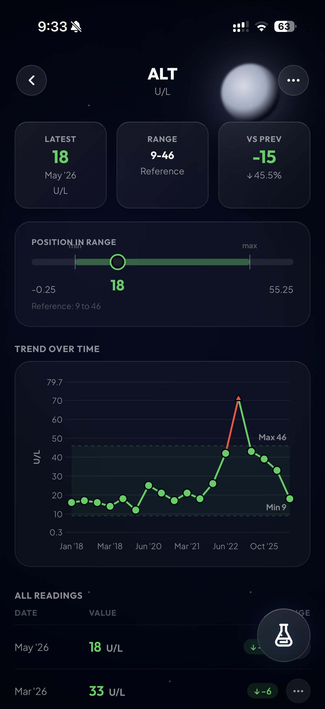
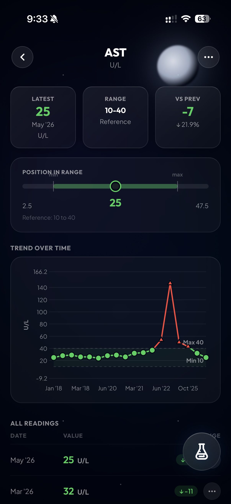

Earlier in 2025, I did bloodwork for the first time in a while, and found I had some insanely high liver enzymes. I'd come off the heels of five years of college, having spent the last ~year and a half drinking like my liver was bulletproof. I realized that something needed to change, and spent the next year of my life committed to achieving the healthiest liver possible. Turns out, if you take care of your liver, it most definitely will take care of you too.

  
Table of Contents

  <ul>
    <li><a href="#the-baseline">The baseline</a></li>
    <li><a href="#step-one-research">Step one: research</a></li>
    <li class="nested"><a href="#the-glutathione-rabbit-hole">The glutathione rabbit hole</a></li>
    <li><a href="#step-two-stop-drinking">Step two: stop drinking</a></li>
    <li><a href="#the-stack">The stack</a></li>
    <li><a href="#going-one-step-further">Going one step further</a></li>
    <li><a href="#the-rematch">The rematch</a></li>
    <li><a href="#what-i-think-worked">What I think worked</a></li>
    <li><a href="#the-verdict">The verdict</a></li>
    <li><a href="#sources-i-used">Sources I used</a></li>
  </ul>

## The baseline

I mentioned at the beginning that this all started because of some bad blood test results. But whcih ones specifically? The main markers came from a Comprehensive Metabolic Panel, something that I used to call this a liver panel, but realized isn't quite right. A CMP covers more than the liver, so I filter it down to the values I care about:

- Total protein
- Albumin
- Globulin
- Albumin/globulin ratio
- Total bilirubin
- Alkaline phosphatase
- AST
- ALT

ALT and AST are the big ones for me because they are the main liver stress enzymes [<a href="#ref-0" class="cite-link">0</a>]. They don't tell the whole story of liver function, but if you have been drinking and those numbers are high, they get your attention pretty quickly.

Albumin, total protein, globulin, and A/G ratio tell more of the surrounding story, helping to explain things like immune activity and whether the body is keeping its basic chemistry in a good place. (I sound like I know what I'm talking about, but most of this is from Google). Bilirubin and alkaline phosphatase are worth watching too, though bilirubin can bounce around for reasons that do not automatically worry me, and alkaline phosphatase is not purely a liver marker.

So while ALT and AST are my focus, the whole picture has to look good.

Now even inside of a normal range, the individual value is still important. After some research, I came across these generalized 'trends' for what makes something more optimal, even if it's the normal range. 
Holding all else equal, if we are within the normal range, here's what you want for each marker in a liver panel:
- Albumin: Higher is better
- A/G Ratio: Higher is better
- Total Protein: Higher is better
- Globulin: Dead middle is better
- ALT: Lower is better
- AST: Lower is better
- Alkaline Phosphatase: Lower is better
- Bilirubin: Makes no difference

This provides a way to differentiate test results that are close but still considered 'within the normal range'. So if I'm comparing two test results that are within the normal range, clinically they may both be considered the same, but biologically one of them might be just slightly better.

One really cool piece of context to this is that I've been getting blood tests since I was seventeen. That is useful because I have my own younger-me data, which is more useful than a generic 'normal range' for these test results. I can look at what my numbers were before I spent a few years making worse decisions.

Now, here was seventeen-year-old me when he got his CMP:

<table class="bloat-table">
  <thead>
    <tr>
      <th>Analyte</th>
      <th>2018 report, age 17</th>
    </tr>
  </thead>
  <tbody>
    <tr><td>Total protein</td><td>7.1 g/dL</td></tr>
    <tr><td>Albumin</td><td>4.7 g/dL</td></tr>
    <tr><td>Globulin</td><td>2.4 g/dL</td></tr>
    <tr><td>A/G ratio</td><td>2.0</td></tr>
    <tr><td>Total bilirubin</td><td>0.7 mg/dL</td></tr>
    <tr><td>Alkaline phosphatase</td><td>90 U/L</td></tr>
    <tr><td>AST</td><td>28 U/L</td></tr>
    <tr><td>ALT</td><td>17 U/L</td></tr>
  </tbody>
</table>

Pretty good, honestly.

Then there was twenty-four-year-old me:

<table class="bloat-table">
  <thead>
    <tr>
      <th>Analyte</th>
      <th>2025 report, age 24</th>
      <th>Change from 2018</th>
    </tr>
  </thead>
  <tbody>
    <tr><td>Total protein</td><td>6.7 g/dL</td><td class="diff-neg">Decrease by 0.4</td></tr>
    <tr><td>Albumin</td><td>4.4 g/dL</td><td class="diff-neg">Decrease by 0.3</td></tr>
    <tr><td>Globulin</td><td>2.3 g/dL</td><td class="diff-neg">Decrease by 0.1</td></tr>
    <tr><td>A/G ratio</td><td>1.9</td><td class="diff-neg">Decrease by 0.1</td></tr>
    <tr><td>Total bilirubin</td><td>0.7 mg/dL</td><td class="diff-neutral">No change</td></tr>
    <tr><td>Alkaline phosphatase</td><td>54 U/L</td><td class="diff-pos">Decrease by 36</td></tr>
    <tr><td>AST</td><td>147 U/L</td><td class="diff-neg">Increase by 119</td></tr>
    <tr><td>ALT</td><td>71 U/L</td><td class="diff-neg">Increase by 54</td></tr>
  </tbody>
</table>

Yikes lol.

While my liver was still functioning generally well at the time of this test, the enzymes were extremely worrisome. As I mentioned before, this was taken after I graduated college. I spent nearly the entire calednar year at a bar, from Summer 2023 to Fall 2024. It was interesting since I had drank little in 2025 (at the time this test was done), but I stopped *because* the hangovers were getting too bad. So I knew any bad results this many months later were a sign of latent liver injury. And keep in mind, I was still drinking, just less frequently due to those hangovers.

**Needless to say, after getting this test, I was motivated to finally take charge of my liver health.**

## Step one: research
#### The glutathione rabbit hole

I started to research more about glutathione, a supplement that could potentially help regenerate my liver. Funyn enough, I had actually dealt with it before. Back in 2022, I went to a men's clinic after my friend convinced me to get my blood tested like him. To optimize as many biomarkers as possible. Their main finding was that my liver was stressed with slightly elevated enzymes, and that I could inject glutathione if I wanted to. They put me on 400mg weekly.

The injections were really painful. It has to go straight into muscle, and it's slightly acidic, so it stings while it goes in. I don't have any hard data on whether those few injections did anything, but my liver was mostly normal at the time anyway. I ended up stopping it and forgetting about glutathione.

When I came back to it in 2025, I had one basic question: can I take this orally and avoid stabbing myself?

As I learned, plain glutathione has a bioavailability problem. One newer paper on glutathione analogues says native oral glutathione has bioavailability of <1% because it gets broken down enzymatically and does not absorb well through the gut [<a href="#ref-1" class="cite-link">1</a>]. That same paper tested modified versions of glutathione and found that one 'N-methylated' analog had much better half-life and oral bioavailability than native glutathione. Sounds promising, but I have no idea where someone would go to buy that.

The more practical thing I found was S-acetyl L-glutathione, usually shortened to SAG.
It's basically a modified glutathione molecule, forced onto an acetyl group that _supposedly_ makes it more stable and helps it get into cells. This was probably the best oral composition out there.

The best human data I found was a small 2018 crossover study in eighteen healthy volunteers. It compared a single large oral dose of S-acetyl glutathione against regular glutathione. The study found higher plasma GSH Cmax and AUC after SAG than after the regular glutathione product, although some of the other results were messier and actually favored regular glutathione on some measures. Definitely not a slam dunk, but it was enough to make SAG look more plausible [<a href="#ref-2" class="cite-link">2</a>].

There was also a 2025 safety assessment in *Food and Chemical Toxicology* that looked at SAG for use in foods and dietary supplements. The summary I found reported no genotoxic signal, an acute oral LD50 above 2000 mg/kg in rats, and a 13-week rat NOAEL of 1500 mg/kg/day. That does not prove anything magical about how it absorbs, but it did make the safety profile look decent [<a href="#ref-3" class="cite-link">3</a>].

At that point, my conclusion was pretty simple: oral glutathione itself is probably not the move, but S-acetyl glutathione is at least interesting enough to try.

## Step two: stop drinking
While the supplements helped, blood tests from the month afterward showed only moderate improvement. My liver enzymes were still elevated. The smart move was easy to understand but hard to do. I needed to stop drinking.

It was about three months of experimenting with supplementation before I fully accepted that I was not going to fix my liver while giving it the same thing that caused the problem. I had already been thinking about going sober for a while, so the bloodwork made that decision feel easier to make. It went from "maybe this would be a good reset" to "I don't think my liver will go back to normal if I don't do this".

I made the decision to stop drinking. It was about 3.5 months after that first concerning blood test. 
My liver continued to improve in the months afterward, but the enzymes were still nothing incredible.

## The stack

After three months sober, and 6.5 months into my journey of committing to improve my liver, I created a supplement stack around glutathione support and general inflammation. This is what I settled on:

- S-acetyl-L-glutathione, 200 mg per day
- NAC, 600 mg per day
- TMG, 4 g per day
- Turmeric, 1 g per day
- Grape seed extract
- Fish oil, specifically Nordic Naturals Complete Omega Xtra
- Elderberry extract, 500 mg per day

The liver part was mostly SAG plus NAC. NAC is a precursor for glutathione synthesis [<a href="#ref-7" class="cite-link">7</a>], and SAG was my attempt to get pure glutathione into my body without injections. TMG was there because I was interested in gains at the gym, and high doses of TMG are known for helping muscle growth [<a href="#ref-8" class="cite-link">8</a>]. Fish oil and turmeric were there for inflammation, and elderberry is more of a general-purpose antiviral I take to stay healthy.

Was this perfectly controlled science? NOPE! But I was going to do it all anyway and see what happened.

At this point, I had changed a bunch of these things at once: no alcohol, better diet, supplements, more health tracking, and a level of motivation I do not usually have. 

*To be fair: I started the supplements **seven months** after I stopped drinking, and my data show that my ALT and AST levels dropped to just-above normal levels when I started supplementation. With drinking, it's usually understood that the liver completes its recovery in a few short months. For this reason, I'm inclined to believe that the supplements were the thing pushing me over the edge here, and into B.L.O.A.T. territory.*

After running the stack for about three months, my numbers came back into the normal range. Nice! My ALT and AST were finally 'normal'. They were at the higher end of normal, but still normal.

The problem was that **normal** was only my first goal. B.L.O.A.T. was still out there.

## Going one step further

Once the oral stack got me back into a safer place, I doubled down on beating my old best test results. 

I started by bringing back injectable glutathione. I went back to the exact same men's clinic that I had visited years ago, paid to see a physician, and explained to her everything I've just shown you. While she thought I was a little obsessed over it, she said it couldn't hurt to try. We settled on 600 mg weekly, slightly more than my OG prescription years ago. It was still painful, and still sucked to do every week, but it was just for a few weeks. I was doing this to give my liver a short-term boost to help it regenerate [<a href="#ref-6" class="cite-link">6</a>].

This was the differentiator. A short few weeks later, May 2026 came around.

## The rematch

Here is the oldest test against the newest test, complete with the trends we talked about before:

<table class="bloat-table">
  <thead>
    <tr>
      <th>Analyte</th>
      <th>2018 report, age 17</th>
      <th>2026 report, age 25</th>
      <th>My Opinion</th>
    </tr>
  </thead>
  <tbody>
    <tr>
      <td>Total protein</td>
      <td>7.1 g/dL</td>
      <td class="diff-pos">7.2 g/dL</td>
      <td class="diff-pos">Better</td>
    </tr>
    <tr>
      <td>Albumin</td>
      <td>4.7 g/dL</td>
      <td class="diff-pos">4.7 g/dL</td>
      <td class="diff-pos">Equal</td>
    </tr>
    <tr>
      <td>Globulin</td>
      <td>2.4 g/dL</td>
      <td class="diff-pos">2.5 g/dL</td>
      <td class="diff-pos">Better (2.7 is technical best)</td>
    </tr>
    <tr>
      <td>A/G ratio</td>
      <td>2.0</td>
      <td class="diff-neg">1.9</td>
      <td>Worse (barely)</td>
    </tr>
    <tr>
      <td>Total bilirubin</td>
      <td>0.7 mg/dL</td>
      <td>1.0 mg/dL</td>
      <td>Doesn't matter</td>
    </tr>
    <tr>
      <td>Alkaline phosphatase</td>
      <td>90 U/L</td>
      <td class="diff-pos">79 U/L</td>
      <td class="diff-pos">Better</td>
    </tr>
    <tr>
      <td>AST</td>
      <td>28 U/L</td>
      <td class="diff-pos">25 U/L</td>
      <td class="diff-pos">Better.</td>
    </tr>
    <tr>
      <td>ALT</td>
      <td>17 U/L</td>
      <td class="diff-pos">17 U/L</td>
      <td class="diff-pos">Equal</td>
    </tr>
  </tbody>
</table>

I started chuckling at the new result. 2026 wins.

I know that not *every* single marker was better in 2026, but most were. A/G ratio was slightly worse, bilirubin rose a little, so if I were trying to fight against myself, there are places to do it. But if you look at the liver enzymes, they are ridiculous now. AST dropped from 147 to 25. ALT dropped from 71 to 17. Even compared with my seventeen-year-old baseline, AST is better and ALT is the same. That is insane to me.

## What I think worked

If I had to rank the interventions, sobriety and glutathione tie for the top spot.

Sobriety is important because you can't really expect your liver to heal if you are continually bombarding it with stress. Cutting alcohol created the perfect space for my liver to regenerate itself, and I'd recommend anyone do the same if they are in a similar situation. 

However, I do think there is a lot to say about injectable glutathione. Injectable glutathione had the clearest impact on my liver enzymes by far. I want to slightly push back on the notion that sobriety is the #1 thing that is going to help someone's liver get to its best functioning state of all time. While avoiding heavy drinking is an absolute must, my data showed that it only led to modest improvements. To actually get to best-functioning territory, the injectable glutathione pushed me over the edge. Take a look at the timeline of my biomarkers below. If sobriety _really_ was the main thing driving this, we would have seen remarkable improvement in these enzymes. We didn't. The most dramatic drop was actually not the time when I went sober, but **the time that I started doing intramuscular glutathione**. Keep in mind this was only for about 6 weeks. I think this is as good a testimonial as any, that these interventions do work.

  <!-- Row 1: screen1 & screen2 + caption -->
  

    

      
      
    

    

      With ALT especially, it's clear that the most significant drop in enzymes occurred when I was using intramuscular glutathione. The original drop from March 2025 onward was after 3 months of sobriety + 6 months of supplementation.

      Also - this is my new blood test tracking app, developed as yet another side project. You can read about it [here](https://sull1van.com/tracking-blood-tests) if interested.
    

  

As far as the supplements go, I don't think any oral supplement is going to outsmart alcohol if heavy alcohol consumption is the main thing stressing your liver. But I do think oral supplements help, such as the SAG and grape seed extract. The research is promising [<a href="#ref-4" class="cite-link">4</a>][<a href="#ref-5" class="cite-link">5</a>], and my test results add more fuel to that fire. S-Acetyl-L-Glutathione is the only one I'd take orally. And after injecting pure glutathione, I learned that it costs only a little more than the supplement anyway. So for anyone who is considering one of the two, I'd say do whatever you are most comfortable with, but know that both will probably help you out in some capacity.

## The verdict

I started with a simple goal: get my liver back into range.

Then, because I was mad at myself for letting it fall out of range, I turned it into a competition against my own teenage bloodwork. And take that, teenage me! Twenty-five year old me is just as good, if not better.

As of May 2026, I have the best liver test results of my life. Maybe not every single marker, if you want to pick at it. But taken as a full picture, especially with AST and ALT, this is the best my liver has ever looked on paper.

B.L.O.A.T. achieved.

## Refreences

<a href="https://www.ncbi.nlm.nih.gov/books/NBK482489/" class="ref-marker">[0]</a> Liver Function Tests: <a href="https://www.ncbi.nlm.nih.gov/books/NBK482489/">https://www.ncbi.nlm.nih.gov/books/NBK482489/</a>

<a href="https://pubmed.ncbi.nlm.nih.gov/40143049/" class="ref-marker">[1]</a> Enhancing the Oral Bioavailability of Glutathione Using Innovative Analogue Approaches: <a href="https://pubmed.ncbi.nlm.nih.gov/40143049/">https://pubmed.ncbi.nlm.nih.gov/40143049/</a>

<a href="https://www.graphyonline.com/archives/IJCND/2018/IJCND-134/" class="ref-marker">[2]</a> Oral Administration of S-acetyl-glutathione: Impact on the Levels of Glutathione in Plasma and in Erythrocytes of Healthy Volunteers: <a href="https://www.graphyonline.com/archives/IJCND/2018/IJCND-134/">https://www.graphyonline.com/archives/IJCND/2018/IJCND-134/</a>

<a href="https://www.sciencedirect.com/science/article/pii/S0278691525000468" class="ref-marker">[3]</a> Safety assessment of S-Acetyl Glutathione for use in foods and dietary supplements: <a href="https://www.sciencedirect.com/science/article/pii/S0278691525000468">https://www.sciencedirect.com/science/article/pii/S0278691525000468/</a>

<a href="https://pmc.ncbi.nlm.nih.gov/articles/PMC3003214/" class="ref-marker">[4]</a> Grape Seed Extract to Improve Liver Function in Patients with Nonalcoholic Fatty Liver Change: <a href="https://pmc.ncbi.nlm.nih.gov/articles/PMC3003214/">https://pmc.ncbi.nlm.nih.gov/articles/PMC3003214/</a>

<a href="https://link.springer.com/article/10.1186/s12906-024-04477-3" class="ref-marker">[5]</a> Effects of grape seed extract supplementation on cardiovascular risk factors, liver enzymes: <a href="https://link.springer.com/article/10.1186/s12906-024-04477-3">https://link.springer.com/article/10.1186/s12906-024-04477-3/</a>

<a href="https://pmc.ncbi.nlm.nih.gov/articles/PMC5549431/" class="ref-marker">[6]</a> Effect of injectable glutathione for treatment of liver disease: <a href="https://pmc.ncbi.nlm.nih.gov/articles/PMC5549431/">https://pmc.ncbi.nlm.nih.gov/articles/PMC5549431/</a>

<a href="https://pmc.ncbi.nlm.nih.gov/articles/PMC8234027/" class="ref-marker">[7]</a> How the body synthesises NAC into glutathione: <a href="https://pmc.ncbi.nlm.nih.gov/articles/PMC8234027/">https://pmc.ncbi.nlm.nih.gov/articles/PMC8234027/</a>

<a href="https://pmc.ncbi.nlm.nih.gov/articles/PMC3844502/" class="ref-marker">[8]</a> Baseline clinical study about TMG which shows it is promising for use in lifting: <a href="https://pmc.ncbi.nlm.nih.gov/articles/PMC3844502/">https://pmc.ncbi.nlm.nih.gov/articles/PMC3844502/</a>

  <button class="img-lightbox-close" aria-label="Close">&#x2715;</button>
  
  click anywhere to dismiss

