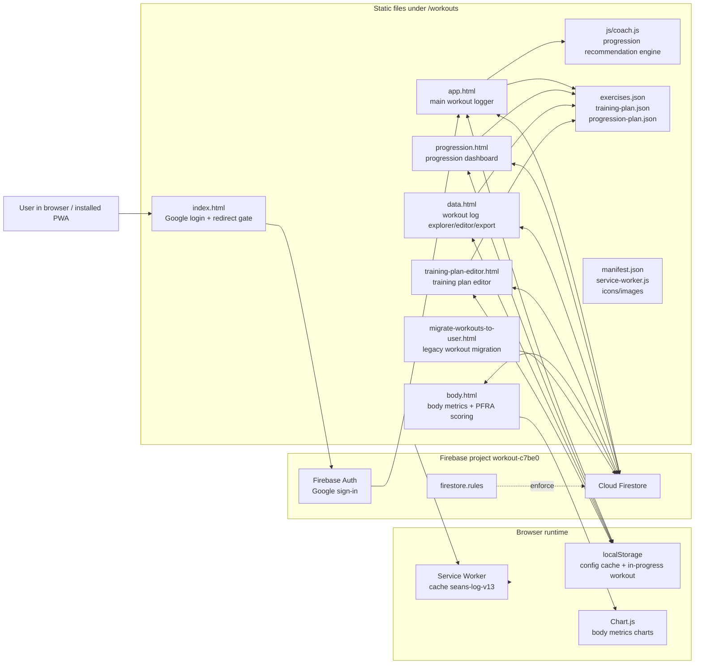
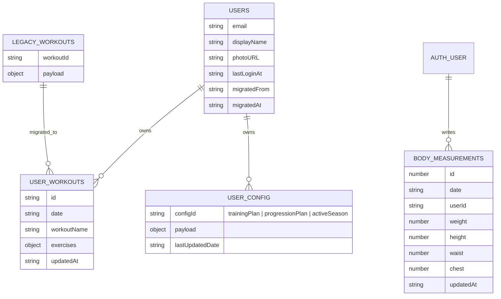
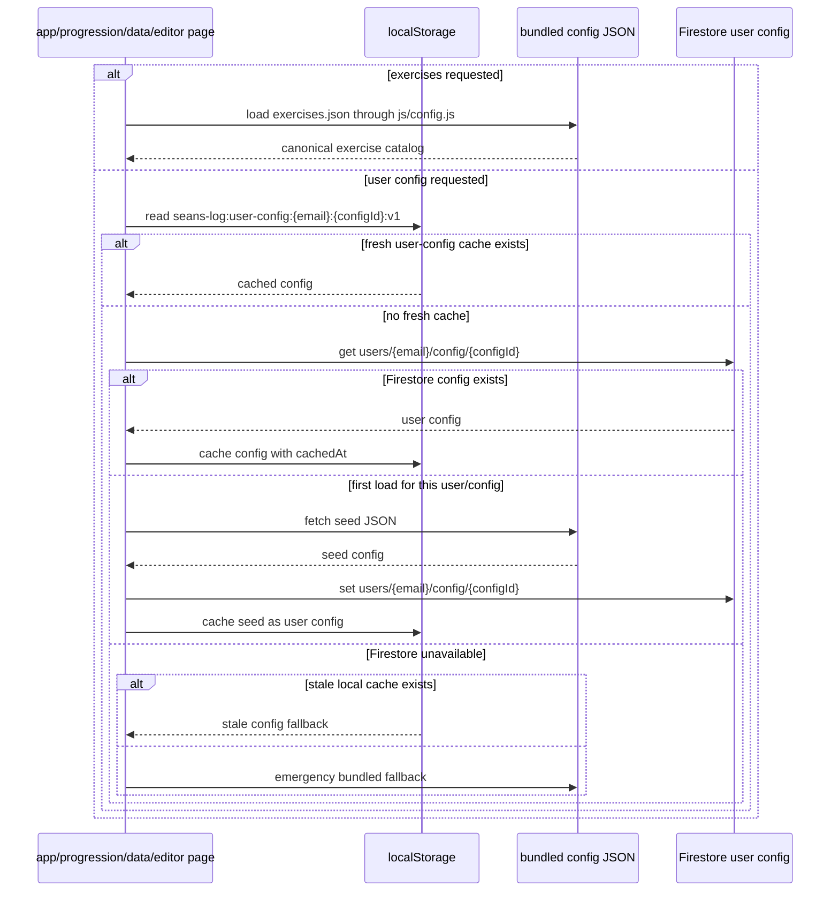
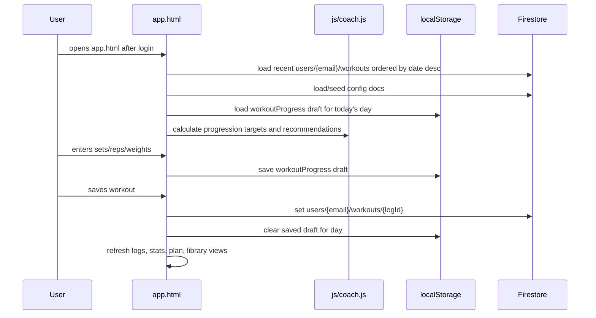
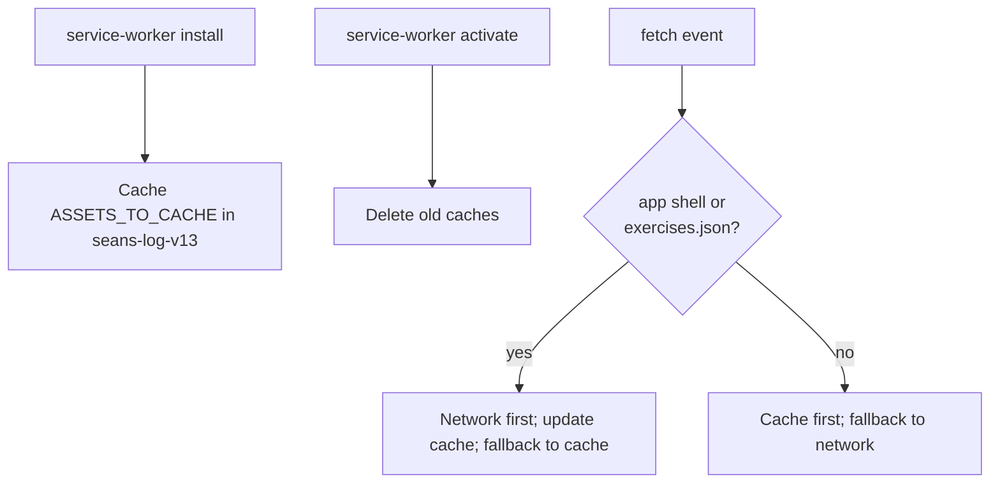

# Sean's Log Workouts Architecture

Source folder:

```text
/Users/sps/GitHub/sull1van.com/workouts
```

This folder is a static, browser-run workout app. There is no local backend in this directory. The app is shipped as HTML/JS/JSON assets, authenticates users with Firebase Auth, stores durable user data in Firestore, and uses browser storage/caches for app-shell and offline-ish behavior.

## High-Level System



## Page Responsibilities

| File | Role | Main data touched |
| --- | --- | --- |
| `index.html` | Login screen and redirect gate. Uses Google sign-in and only redirects to approved local pages. | Firebase Auth only |
| `app.html` | Main daily workout experience: today's plan, workout logging, recent logs, stats, plan view, exercise library, progression coach UI. | `exercises.json`, `users/{email}`, `users/{email}/workouts`, `users/{email}/config/*`, `localStorage.workoutProgress` |
| `progression.html` | Active-season progression dashboard. Queries only workouts on or after `activeSeason.startDate`, derives each lift's baseline from its first season performance, and shows season PRs, rolling seven-day activity, relative targets, and strength/load charts. | `exercises.json`, `users/{email}/workouts`, `trainingPlan`, `progressionPlan`, `activeSeason`, local config cache |
| `data.html` | Data explorer/editor/export tool for workout logs. Can edit/delete logs and validate against exercise config. | `exercises.json`, `users/{email}/workouts` |
| `training-plan-editor.html` | UI for editing the user's training plan config. Saves only `trainingPlan`; does not touch workout logs or in-progress workout state. | `exercises.json`, `users/{email}/config/trainingPlan`, local config cache |
| `body.html` | Body measurements dashboard, Chart.js visualization, and USAF/PFRA-style scoring tools. | Top-level `bodyMeasurements` collection filtered by `userId` |
| `migrate-workouts-to-user.html` | One-off migration utility from legacy top-level `workouts` collection to per-user `users/{email}/workouts`. | top-level `workouts`, `users/{email}/workouts`, `users/{email}` |
| `service-worker.js` | PWA shell cache. Network-first for app/editor shell and `exercises.json`, cache-first for other static assets. | Cache Storage `seans-log-v13` |
| `js/strength.js` | Shared formula classifier and estimated 1RM calculator. Treats `NONE` as rep-only, uses Epley for blank formulas, and caps estimate calculations at 12 reps. | Exercise metadata and working sets supplied by page callers; no direct Firestore calls |
| `js/records.js` | Shared active-season PR evaluator and timeline. Uses estimated 1RM for formula-eligible exercises and max reps for `NONE` exercises. | Exercise metadata, active season start date, and in-memory season logs supplied by page callers; no direct Firestore calls |
| `js/coach.js` | Shared browser module for progression/recommendation calculations and SVG chart snippets. | Inputs supplied by `app.html`; no direct Firestore calls |

## Firestore Shape



Primary per-user paths used by most pages:

```text
users/{email}
users/{email}/workouts/{logId}
users/{email}/config/trainingPlan
users/{email}/config/progressionPlan
users/{email}/config/activeSeason
```

Additional collections:

```text
workouts/{workoutId}
bodyMeasurements/{timestampId}
```

`workouts/{workoutId}` is legacy read-only source data for migration. `bodyMeasurements/{timestampId}` is currently top-level and keyed by `userId`, not nested under `users/{email}`.

## Config Loading Flow

`exercises.json` is the sole source of truth for the global exercise catalog. Every page loads it through `js/config.js`. The service worker checks the network first and falls back to its cached copy when offline. Exercise data is never read from or written to Firestore.

User-owned configuration, such as `trainingPlan`, remains in Firestore with a local cache and bundled seed fallback.
The app's manual Training Plan sync is the explicit reset path: it fetches `training-plan.json`, overwrites the user's Firestore `trainingPlan` document, and refreshes the local config cache.



Configuration files:

| File | Purpose |
| --- | --- |
| `exercises.json` | Canonical exercise catalog keyed by exercise ids like `ex001`. Optional `1repmaxformula` expressions use `w` for weight and `r` for reps. Includes `lastUpdatedDate`; never synced to Firestore. |
| `training-plan.json` | Seven-day schedule and workout definitions. The `schedule` array maps Sunday through Saturday. |
| `progression-plan.json` | Progression block metadata, target weights, baseline policy, and recommendation defaults. |

## Workout Logging Flow



## PWA / Offline Behavior



`service-worker.js` special-cases `exercises.json` as network-first because it is the canonical catalog. Other bundled JSON files remain cache-first and are used as seeds or fallbacks for user-owned configuration.

## Security Model

`firestore.rules` currently says:

```text
users/{email}/{document=**}
  read/write allowed only when request.auth.token.email.lower() == email

workouts/{workoutId}
  read allowed only for sspsful@gmail.com
  write denied
```

Important caveat: `body.html` reads/writes top-level `bodyMeasurements` documents filtered by `userId`. The `firestore.rules` file in this folder does not include an allow rule for `bodyMeasurements`, so either:

- deployed Firebase rules differ from this local file, or
- the body measurement feature will fail under these local rules.

That is the one schema/security mismatch I found while mapping the folder.

## Static Asset / File Map

```text
workouts/
├── index.html                       # login and redirect gate
├── app.html                         # main workout logger
├── progression.html                 # progression dashboard
├── body.html                        # body metrics and PFRA scoring
├── data.html                        # workout data explorer/editor/export
├── training-plan-editor.html        # training plan editor
├── migrate-workouts-to-user.html    # legacy migration helper
├── js/
│   ├── config.js                    # shared static exercise loader
│   ├── strength.js                  # safe lift-specific estimated-1RM formulas
│   ├── coach.js                     # progression recommendation engine
│   └── records.js                   # shared active-season PR calculations
├── exercises.json                   # canonical exercise catalog
├── training-plan.json               # seed weekly plan
├── progression-plan.json            # seed progression targets
├── service-worker.js                # PWA cache logic
├── manifest.json                    # PWA manifest
├── firestore.rules                  # intended Firestore access model
├── archivedStuff/                   # old plans/tools/stats pages
├── USAF_PFRA_Scoring.xlsx           # scoring reference asset
├── apple-touch-icon.png
├── maskable-icon.png
└── sean.jpg
```

## External Dependencies

| Dependency | Used by | Purpose |
| --- | --- | --- |
| Firebase JS SDK `11.2.0` | HTML pages with auth/data | Auth, Firestore reads/writes, migration |
| Google Fonts | UI pages | Bebas Neue, Space Mono, Outfit |
| Chart.js `4.4.7` | `body.html` | Body measurement charts |
| Browser Cache Storage | `service-worker.js` | PWA app-shell cache |
| Browser localStorage | app/config pages | User config cache and in-progress workout drafts |

## Operational Notes

- This is currently a static app with page-local JavaScript rather than a module-bundled frontend.
- Several pages duplicate Firebase setup and config-loading helpers. The shared logic is conceptual, not centralized, except for `js/coach.js`.
- Config cache keys use:

  ```text
  seans-log:user-config:{email}:{configId}:v1
  ```

- In-progress workout drafts use:

  ```text
  workoutProgress
  ```

- The training plan editor writes only `users/{email}/config/trainingPlan`; it intentionally leaves workout logs and in-progress drafts alone.
- The migration page copies legacy `workouts` documents into `users/{email}/workouts` in batches and annotates `users/{email}` with migration metadata.
